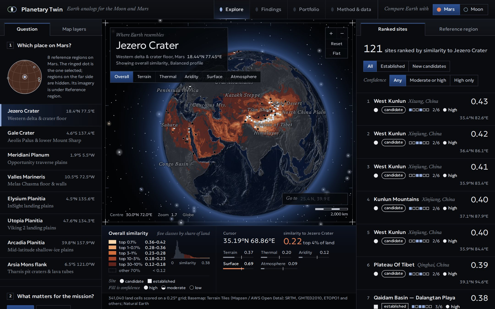
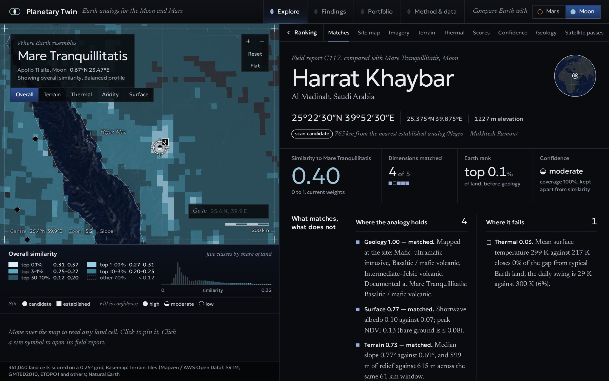
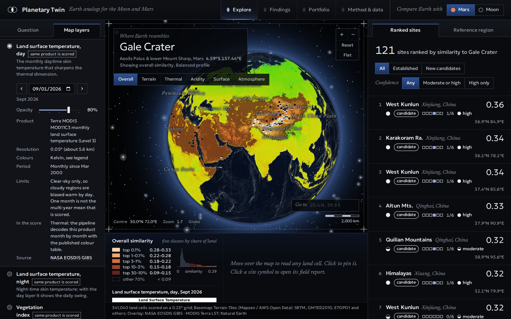
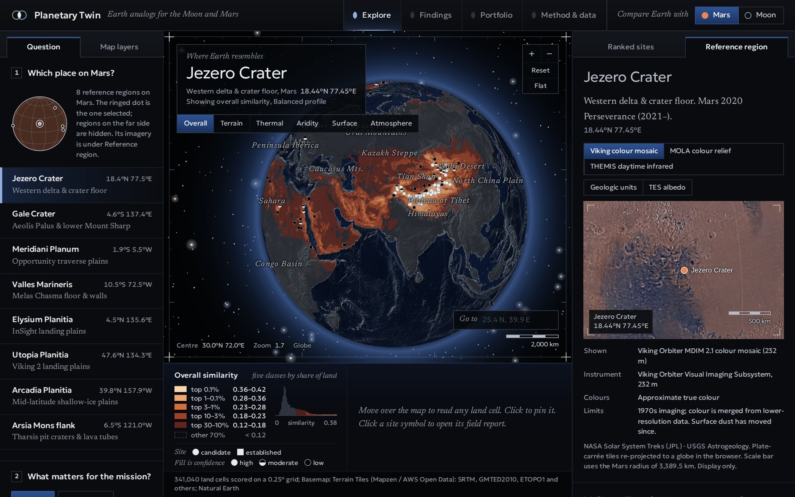
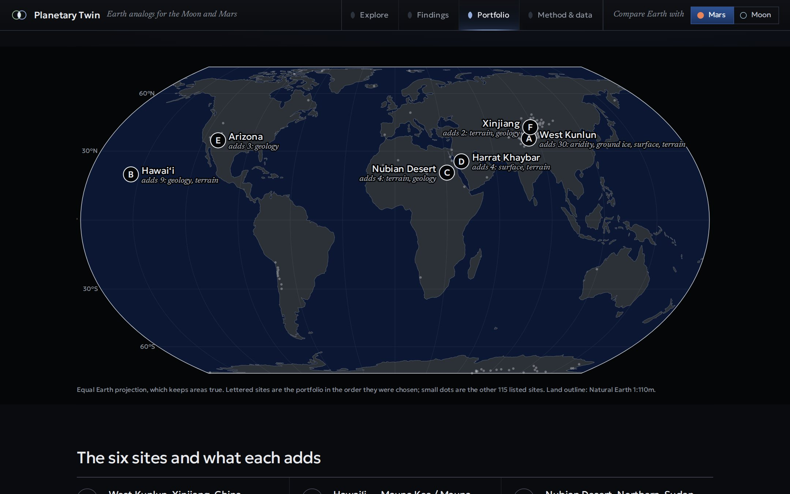

# PLANETARY TWIN

**Where on Earth measurably resembles a specific place on the Moon or Mars?**
NASA Space Apps Challenge 2026 · *Identify Earth Locations that Analog Permanent Moon Base Locations and Mars*

Planetary Twin scores all 341,040 land cells of a 0.25° global grid against 13 named regions of the Moon and Mars
(Jezero, Gale, Shackleton, Mare Tranquillitatis and nine more), using real, public NASA / ESA / NOAA data for terrain,
temperature, moisture, surface and atmosphere, then checks the leading candidates against independent geological maps.
The result is an interactive research instrument in which every number can be traced to its dataset, and in which
similarity and confidence are reported separately: similarity in colour, confidence as a fill.



## What it found

| | Result | How it was established |
|---|---|---|
| **Proof** | 11 of 13 analog sites that the community chose for their *environment* (Atacama, McMurdo Dry Valleys, Qaidam, Ladakh, Dome C, Death Valley …) fall in the top quarter of Earth's land in the ranking, 7 in the top tenth. Chance would put about 3 there (one-sided p ≈ 9 × 10⁻⁷). Sites chosen for a mineral, a crater or a nearby station (Río Tinto, Ries) are *not* recovered, as a physical-similarity method should predict. | Known sites are never read by the scoring code. Their rank is calibrated against the same statistic computed for every land cell. |
| **Surprise** | **Harrat Khaybar, Saudi Arabia** (25.4°N 39.9°E) matches Mare Tranquillitatis in **4 of 5** testable dimensions: terrain, surface, dryness and rock type. Only temperature fails. It is the only site in the detailed tier to match four dimensions for any lunar region. | Top 0.05% of Earth's land in the blind scan; a geological map consulted afterwards confirms Neogene basalt. The field hosts Umm Jirsan, Arabia's longest known lava tube, a counterpart to the documented lunar lava tubes that the scan itself cannot see. A literature search found no analog-science study of the site. Confidence: moderate. |
| | **West Kunlun plateau** (35.4°N 82.6°E, 5,200 m) is the single best land cell on Earth for Jezero Crater in 4 of 5 mission profiles, ahead of the established Qaidam Basin site 850 km east. | Rank holds across 150 perturbed runs (percentile 99.96–100). Independent permafrost literature describes the area as the coldest, driest part of the Tibetan Plateau. |
| | **Mongolia's Gobi** (42.9°N 101.4°E) is the top terrain-and-surface match on Earth for the lunar maria, but only a partial Mars analog: not dry or cold enough. | Tested because the brief asks. Reported as measured, including where the popular claim does not hold. |
| **Usefulness** | A portfolio of 6 sites covers 52 of 77 region-by-dimension requirements. Thermal (0 of 13) and atmosphere (0 of 8) are covered nowhere on Earth. | Greedy set cover over all listed sites; the uncovered cells are shown, not hidden. |

Every finding lists its measurements, its important differences, and how far the novelty claim can be trusted.
A candidate is a hypothesis for field work, not a conclusion.

## Run the application

Live: **https://tariatiineserguu.github.io/Nasa-Hackathon/**. Every push to `main` rebuilds and publishes it through
`.github/workflows/pages.yml`.

The processed results are committed, so the app runs without the data pipeline.

```bash
cd web
npm install
npm run dev          # http://localhost:5173
# or: npm run build && npx vite preview
```

Requires Node 18+. All scores, rankings, charts and the similarity layer are local files. Map backgrounds and optional
overlays are fetched live from open services that need no key (NASA GIBS, NASA Solar System Treks, EOX, Macrostrat,
AWS Terrain Tiles, the Copernicus catalogue). If one of them is down the map says so and everything scored still works.

Deep links work, for example `#/explore?t=tranquillitatis&s=c117` opens the Harrat Khaybar field report, and
`#/explore?t=gale&l=terrain&b=s2&o=ndvi` opens Gale Crater's terrain layer over Sentinel-2 with the vegetation overlay.

## What is in the app

- **Explore** — the research workspace. A globe (or flat map) on which the best-scoring 30% of land is drawn in five
  classes with their score ranges. Switch Moon / Mars, pick a reference region, choose a mission profile or drag the
  weights: the layer, legend and ranking recompute in the browser. View any single dimension. Move over any land cell
  to read its score, percentile and dimension scores; click to pin it; type coordinates to go there. Filter
  established analogs against new candidates and set a minimum confidence. A layer panel offers four basemaps, eleven
  dated observation overlays and five reference layers, each with its product, resolution, limits and source.
- **Field report** (site dossier) — coordinates in two forms, what matches and what fails side by side, an interactive
  site map with the 61 km scored window, geologic units, dated Sentinel-2 passes and Sentinel-1 radar, same-scale
  imagery and shaded relief with a table of what is and is not comparable, elevation profiles, slope distributions,
  temperature curves, a per-variable score table with units, sources and evidence kind, confidence broken into
  coverage / evidence quality / rank stability, mapped geology, a live list of recent satellite passes, suggested uses,
  an interactive map of the reference region on Mars or the Moon, and an Earth · Mars · Moon triptych.
- **Findings** — the three results above with their evidence, plus the validation table.
- **Portfolio** — the complementary site set on an equal-area world map, a roster of what each site adds, the coverage
  matrix, and what stays uncovered.
- **Method & data** — formulas, tolerances, sensitivity results, all 17 scored datasets with resolution and limits,
  every map layer that is shown but not scored, the outside sources that were examined and what was decided for each,
  and the limits of the work.

The visual system (Observatory) is documented in [`DESIGN.md`](DESIGN.md).

| Field report | Map layers |
|---|---|
|  |  |
| **Reference region on Mars** | **Portfolio** |
|  |  |

## Method in brief

The comparison depends on what kind of variable it is (`pipeline/score.py`):

| Kind | Used for | Score |
|---|---|---|
| Direct match | slopes, relief, roughness scaling, albedo, dust loading | `0.5 ^ (|x − x★| / τ)`, with τ = half the robust spread of that variable over Earth's land |
| Gap closure | temperature, diurnal range, rainfall, pressure, water vapour — things Earth never reaches | fraction of the way from the median of Earth's land to the planetary value |
| Category affinity | rock type (listed sites only) | best affinity between mapped and documented lithologies |

Variables combine into dimensions, and dimensions into an overall score, by **geometric** mean, so a failed dimension
cannot be averaged away. Terrain is measured identically on all three bodies: a 32 × 32 window at 1.9 km spacing on a
local equal-distance grid, from elevation models whose pixels are almost the same size (ETOPO 1.85 km, MOLA 1.85 km,
LOLA 1.90 km).

**Confidence = coverage × evidence quality × rank stability**, and never alters the similarity number.
Stability comes from 150 runs that redraw the weights, the tolerance, the rainfall floor and the aggregator.

## Data

All sources are public and need no login. Full provenance, resolution and limits are in the app and in
`pipeline/provenance.py`.

| Body | Dataset | Used for | Kind |
|---|---|---|---|
| Earth | NOAA ETOPO 2022, 60″ | terrain | measured |
| Earth | MODIS LST, NDVI, albedo, land cover (via NASA GIBS, decoded with the official colormaps) | temperature detail, bare ground, albedo, land mask | measured |
| Earth | MERRA-2 via NASA POWER | temperature, diurnal cycle, pressure, water vapour | model (reanalysis) |
| Earth | GPM IMERG and CERES SYN1deg via NASA POWER | rainfall, aerosol | measured |
| Earth | Macrostrat geologic map compilation | lithology at listed sites | compiled maps |
| Mars | MGS MOLA MEGDR 32 px/deg (PDS) | terrain | measured |
| Mars | MGS TES bolometric albedo (USGS) | albedo | measured |
| Mars | Mars Climate Database v6.2 | temperature, pressure, dust | **model** |
| Moon | LRO LOLA LDEM 16 px/deg (PDS) | terrain | measured |
| Moon | LRO Diviner GCP and PRP (PDS, read by HTTP range request) | temperature, polar cold traps | measured |

Display only, never scored: Sentinel-2 cloudless (EOX / Copernicus), THEMIS day-IR and LROC WAC mosaics (USGS), and the
25 interactive map layers served by NASA GIBS, NASA Solar System Treks, Macrostrat and AWS Terrain Tiles. A displayed
tile is a picture of a product, not the product: where a GIBS-served product is scored, the pipeline fetches and
decodes it separately. [`docs/DATA_SOURCES.md`](docs/DATA_SOURCES.md) records every outside source that was examined
(JAXA G-Portal, ESA Open Science Data, Copernicus Data Space, RADARSAT-1, RCM, LRO Diviner, PDS, GIBS, Earthdata) and
why each was scored, displayed, searched or left out.

## Reproduce the analysis

```bash
python3 -m venv .venv && . .venv/bin/activate
pip install -r pipeline/requirements.txt
bash pipeline/run_all.sh        # ~1.2 GB download, ~25 min, every step cached
python pipeline/test_pipeline.py
```

| Step | Script |
|---|---|
| Download rasters | `fetch_raw.sh`, `fetch_power.py`, `fetch_gibs.py`, `fetch_mcd.py`, `fetch_diviner.py` |
| Earth feature grid | `build_earth.py` |
| Moon / Mars reference features | `build_targets.py` |
| Scoring, candidates, geology, sensitivity, validation, portfolio | `analyze.py` (uses `score.py`, `terrain.py`, `geology.py`) |
| Imagery and findings text | `imagery.py`, `findings.py` |
| Coastlines, boundaries and place names for the maps (display only, standard library) | `fetch_reference.py` |

Findings text is generated from the output files, so the prose cannot drift from the numbers.

## Tests

- `pipeline/test_pipeline.py` — 10 checks on the calculations (window spacing on all three bodies, known-slope plane,
  kernel and gap-closure values, aggregation, geology scoring).
- `tests/e2e.mjs` — 90 browser checks with Playwright. The first 25 are the regression set: map and layer render,
  client-side scores equal the Python pipeline's, profiles / sliders / filters / layers, dossier, deep links,
  missing-data behaviour. The rest cover the cartography: legend classes, layer panel and dates, cursor readout,
  coordinate navigation, projections, the site map and its 61 km window, the Moon / Mars map, satellite-pass search,
  the portfolio map and matrix, the layer and source tables, and phone and tablet layouts. Checks that need an outside
  service report SKIP, not FAIL, when it is unreachable.

## Limits you should know

- No site on Earth reproduces lunar or Martian gravity, vacuum or thin CO₂ air, or the radiation environment.
- Terrain is compared at 1.9–15 km baselines. Rock abundance and metre-scale hazards are not assessed.
- Mars climate values are model output. Earth's diurnal range, pressure and humidity are reanalysis. Ground ice is
  inferred from temperature. All are labelled and down-weighted in confidence.
- Rainfall products over-read in hyper-arid cores, so dryness scores saturate at 10 mm/yr and are conservative there.
- Inputs range from 0.5 km to 110 km. Valley-scale microclimates are partly averaged with their surroundings.
- Geology uses 1:1M–1:50M map units classified by keyword. Impact structures, lava tubes and periglacial landforms
  are not scored.
- Lanzarote could not be scored (the island is mostly water at 0.25°).
- "No published analog study found" means one web search on 13 November 2026 found none. It is not proof of absence.

## Repository layout

```
pipeline/   data acquisition, feature extraction, scoring, validation (Python)
web/        interactive application (React + TypeScript + MapLibre GL, Vite)
web/public/data, web/public/img   committed pipeline outputs used by the app
tests/      browser end-to-end checks
docs/       presentation, screenshots and the data-source assessment (DATA_SOURCES.md)
DESIGN.md   the Observatory design system as implemented
PROGRESS.md decisions, findings, limitations
```

Data credits: NASA (PDS Geosciences Node, LP DAAC, GIBS, POWER, GMAO, GSFC, JPL), NOAA NCEI, USGS Astrogeology,
LMD / ESA / CNES (Mars Climate Database), ESA Copernicus via EOX and the Copernicus Data Space catalogue,
NASA Solar System Treks (JPL), Macrostrat (CC-BY 4.0), Natural Earth, Terrain Tiles (Mapzen / AWS Open Data).
We acknowledge the use of imagery provided by services from NASA's Global Imagery Browse Services (GIBS), part of
NASA's Earth Science Data and Information System (ESDIS).
