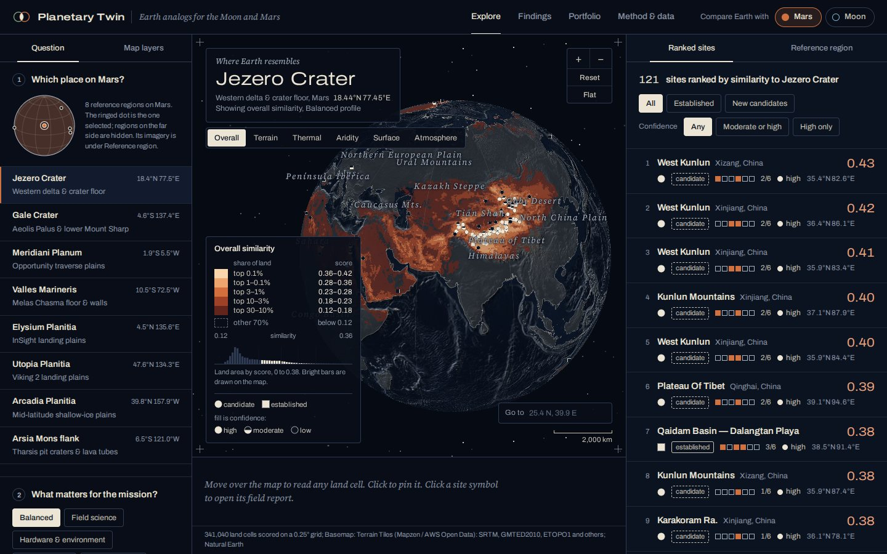
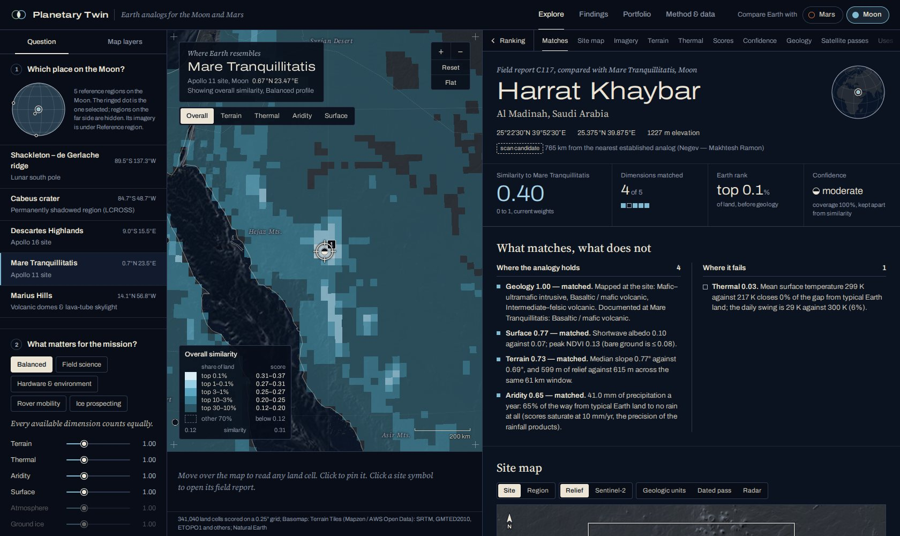
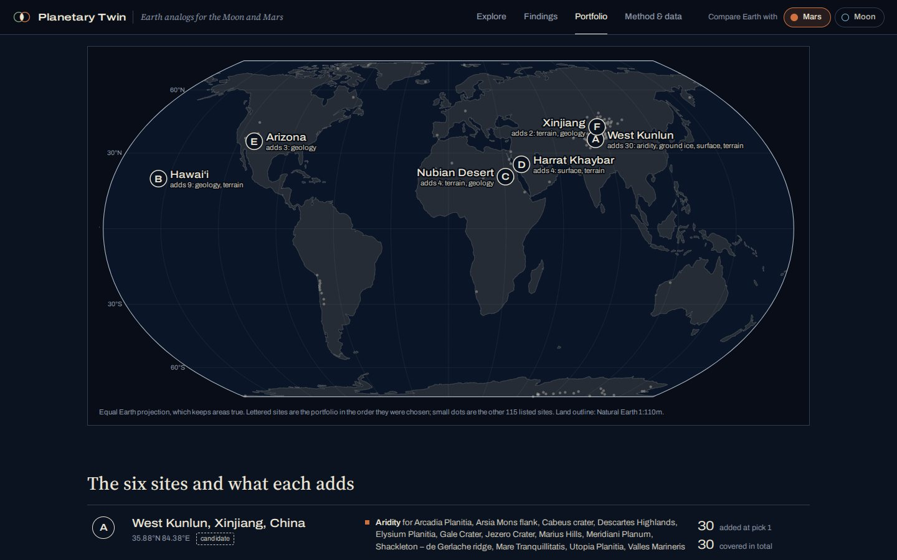

# PLANETARY TWIN — presentation

*NASA Space Apps Challenge 2026 · about 4 minutes, 8 slides, then a live demo*

---

## 1 · The question

Every lunar and Martian mission rehearses on Earth first. The sites used today were chosen over fifty years by
reputation, road access and where a research station happened to be.

**Nobody has asked the planet itself: which ground measurably resembles this specific place on the Moon or Mars?**

> Say: "We did not compare 'the Gobi' with 'Mars'. We compared 341,040 pieces of Earth with Jezero Crater, with
> Shackleton, with eleven other named places."

---

## 2 · What we built

An atlas that scores every land cell on Earth against 13 regions of the Moon and Mars, using only real, public data
from NASA, NOAA, USGS, ESA and the Mars Climate Database. Drag a weight and the whole planet re-ranks in the browser.

---

## 3 · One measurement, three worlds

- Terrain is sampled the same way on Earth, Mars and the Moon: a 61 km window at 1.9 km spacing, from three elevation
  models whose pixels happen to be the same size on the ground.
- The comparison follows the variable. Slopes and albedo are matched directly. Temperature, rainfall and pressure are
  scored by **how much of the gap to the planetary value a site closes**, because no place on Earth reaches it.
- Dimensions combine by geometric mean. An ice sheet is bare but not rock-coloured; it does not get to average that away.

> Say: "Our first version ranked the Antarctic ice sheet first for everything. That bug is why the method is
> stricter now, and it is written up in the repository."

---

## 4 · Proof: it finds the sites scientists already trust

We hid 26 established analog sites from the scoring code and asked where they landed.

| Chosen for | Sites | In the top quarter of Earth's land | Chance |
|---|---|---|---|
| Environment (Atacama, Dry Valleys, Qaidam, Ladakh …) | 13 | **11** | ~3 |
| Geology or logistics only (Río Tinto, Ries …) | 13 | 7 | ~3 |

p ≈ 9 × 10⁻⁷ for the first row. The second row is the honest part: a method that measures environment *should not*
find sites chosen for a mineral or a crater, and it does not.

---

## 5 · Surprise: a lunar mare in Saudi Arabia

**Harrat Khaybar** matches Mare Tranquillitatis in **4 of 5** dimensions: terrain, surface, dryness, rock type.

- Found by the blind scan in the top 0.05% of Earth's land.
- Basalt confirmed afterwards from an independent geological map.
- The field contains Arabia's longest known lava tube. The Moon has lava tubes under Marius Hills and the
  Tranquillitatis pit. Our scan cannot see caves, and still pointed here.
- We found no analog study of the site. Confidence: moderate, and we say so.

What fails: temperature. 299 K against the Moon's 217 K mean and 300 K daily swing. Nothing on Earth fixes that.

---

## 6 · Two more results

- **West Kunlun, 5,200 m**: the best land cell on Earth for Jezero Crater in 4 of 5 mission profiles, ahead of the
  established Qaidam Basin site, and stable across 150 stress runs.
- **Mongolia's Gobi**: the best terrain match on Earth for the lunar maria. For Mars it is only partial, since it is
  not dry or cold enough. The data support a narrower claim than the popular one, and a more useful one: build the
  Gobi's analog work on mobility and operations, not on climate.

---

## 7 · Usefulness: a portfolio, and its gaps

Six sites cover 52 of 77 region-by-dimension requirements. Thermal and atmosphere are covered **nowhere on Earth**.
A mission planner sees at a glance what field work can teach and what needs a vacuum chamber.

---

## 8 · Why trust it

- Every value is labelled measured, model or proxy, with its source and resolution.
- Similarity and confidence are separate numbers.
- Text in the Findings page is generated from the output files, so prose cannot drift from data.
- The whole pipeline reruns from public data with one script. Tests cover the calculations and the interface.

**Planetary Twin does not say "go here". It says "here is the evidence, here is what is missing, and here is how
sure we are."**

---

## Live demo script (90 seconds)

1. Open **Explore**. Mars, Jezero. "Colour is similarity. The bright patch is the western Tibetan Plateau."
2. Drag **Thermal** to 4. "Antarctica lights up. That is the trade a mission has to make."
3. Switch to **Moon → Mare Tranquillitatis**. Click rank 1, **Harrat Khaybar**.
4. Scroll the dossier: same-scale imagery, the profile and slope curves lying on top of each other, the temperature
   chart that shows the one thing that fails.
5. Open **Portfolio**. Point at the two empty columns. "This is what Earth cannot give us."
6. Open **Method & data**. Expand one dataset. "Every number has a source and a limit."
